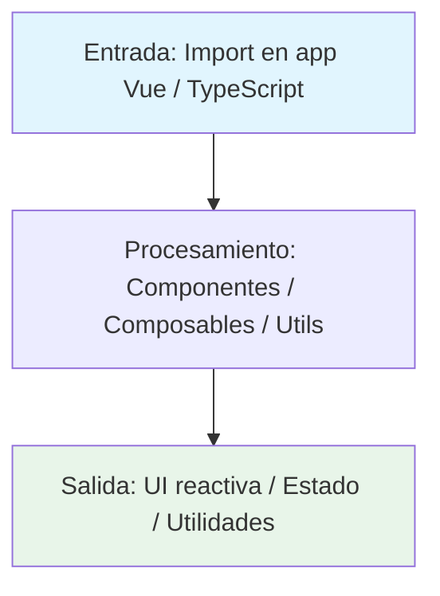

# Vue libvasak

Components for Applications

---

## Tecnología

[](https://vuejs.org/) [](https://www.typescriptlang.org/) [](https://bun.sh/)

## Estado

[](https://github.com/Vasak-OS/vue-libvasak/actions/workflows/ci.yml)
[](https://github.com/Vasak-OS/vue-libvasak/releases)
[](LICENSE)
[](https://sonarcloud.io/summary/new_code?id=Vasak-OS_vue-libvasak)
[](https://sonarcloud.io/summary/new_code?id=Vasak-OS_vue-libvasak)
[](https://github.com/Vasak-OS/vue-libvasak)

---

## Descripción

Components for Applications

**Para el usuario:** Components for Applications

**Integración VasakOS:** Integra con el ecosistema VasakOS vía D-Bus y configuración compartida.

---

## Arquitectura (diagramas)

### Flujo de datos



### Componentes internos

```mermaid
flowchart LR
    subgraph App[{{APP_NAME}}]
        UI[{{UI_DESC}}]
        Core[{{CORE_DESC}}]
    end
    style UI fill:#f3e5f5
    style Core fill:#e3f2fd
```

### Integración en el sistema VasakOS

```mermaid
C4Context
    title {{APP_NAME}} en VasakOS
    Person(usuario, "Usuario", "Persona que usa el sistema")
    System_Boundary(c1, "VasakOS") {
        System(app, "{{APP_NAME}}", "{{ONE_LINER}}")
        {{SYSTEM_EXT}}
    }
    {{SYSTEM_EXT_EXTERNAL}}
    Rel(usuario, app, "Usa")
    {{RELATIONS}}
```

---

## Instalación

### Desde npm (recomendado)

```bash
# Con bun (recomendado para proyectos VasakOS)
bun add @vasakgroup/vue-libvasak

# Con npm
npm install @vasakgroup/vue-libvasak

# Con pnpm
pnpm add @vasakgroup/vue-libvasak
```

### Desde fuente (desarrollo de la librería)

```bash
git clone https://github.com/Vasak-OS/vue-libvasak.git
cd vue-libvasak

# Instalar dependencias
bun install

# Build biblioteca
bun run build
```

---

## Uso rápido

```typescript
import { Button, Card, Dialog, useTheme, useConfig, useI18n } from '@vasakgroup/vue-libvasak';
import '@vasakgroup/vue-libvasak/style.css'; // Estilos base (Once UI + VasakOS)

// Registrar componentes globalmente
const app = createApp(App);
app.use(Button);
app.use(Card);
app.use(Dialog);
// ... registra los que necesites

// Usar composables
const { theme, toggleTheme, colorScheme } = useTheme();
const { config, updateConfig } = useConfig();
const { t, locale, setLocale } = useI18n();
```

### Atajos / flags principales

| Acción | Código |
|--------|--------|
| Instalar | `bun add @vasakgroup/vue-libvasak` |
| Importar componentes | `import { Button } from '@vasakgroup/vue-libvasak'` |
| Importar estilos | `import '@vasakgroup/vue-libvasak/style.css'` |
| Usar composables | `const { theme } = useTheme()` |

> **Captura:** `assets/demo.gif` *(placeholder — sustituir por GIF real)*

---

## Configuración

(biblioteca — la configuración la hace la app que la consume vía `tauri-plugin-config-manager`)

### Variables de entorno

| Variable | Descripción | Por defecto |
|----------|-------------|-------------|
| `VASAK_DEBUG` | Activa logs de depuración en consola | `false` |
| `VASAK_PROFILE` | Perfil de rendimiento: balanced, performance, power-save | `balanced` |

### Integración con `tauri-plugin-config-manager`

- Provee componentes que respetan `--ui-primary`, `--ui-surface`, `--ui-focus`, etc.
- Usa `vicon` para iconos del tema del sistema
- Radio de bordes vía `--ui-radius`
- La app host debe proveer el tema vía config-manager

---

## Desarrollo

### Requisitos

- **Rust:** `rustup` toolchain estable (`rust-toolchain.toml` fija la versión)
- **Node / bun:** `bun` ≥ 1.1 (nunca npm/yarn/pnpm para apps Tauri)
- **Sistema:** `pkg-config`, `libgtk-3-dev`, `libwebkit2gtk-4.1-dev`, `libssl-dev`
- *Ninguna adicional (solo bun)*

### Dependencias de desarrollo

#### Sistema (paquetes Arch / Debian / Fedora)

`base-devel`, `pkgconf`, `libssl-dev`, `libwebkit2gtk-4.1-dev`, `libgtk-3-dev`, `libayatana-appindicator3-dev`, `librsvg2-dev`, `gstreamer1.0-plugins-base`, `gstreamer1.0-plugins-good`, `libpipewire-0.3-dev`, `libwireplumber-0.5-dev`, `libdbus-1-dev`, `libudev-dev`, `libxkbcommon-dev`, `libwayland-dev`, `meson`, `ninja`, `clang`, `lld`

#### Rust

`rustup` → `stable` + `rustfmt` + `clippy`

#### Node

**Solo `bun`** (nunca npm/yarn/pnpm para apps Tauri). `bun --version` ≥ 1.1

#### Herramientas CLI

`just` (command runner), `cargo-binstall` (opcional), `cargo-llvm-cov` (para cobertura)

### Correr en desarrollo

```bash
# Dev server (Storybook / VitePress para documentar)
bun run dev

# Build
bun run build

# Tests
bun test
```

### Compilar / Build de release

```bash
# Build producción (genera dist/)
bun run build

# Publicar a npm
npm publish
```

### Targets principales

```bash
# Desarrollo
bun run dev

# Build producción
bun run build

# Solo frontend
bun run build

# Solo backend Rust
(no aplica — solo TypeScript/Vue)

# Lint + tipos (pre-commit / CI)
bunx --bun biome check .
bunx vue-tsc --noEmit
```

### Pruebas

```bash
# Suite completa
bun test

# Tipos
bunx vue-tsc --noEmit

# Lint
bunx --bun biome check .
```

### Convención de commits

[Conventional Commits](https://www.conventionalcommits.org/es/v1.0.0/):

```
<tipo>(<ámbito>): <descripción corta>

[cuerpo opcional]

[pie opcional: Closes #N]
```

Tipos habituales: `feat`, `fix`, `bugfix`, `docs`, `ci`, `chore`, `security`, `refactor`, `perf`, `test`.

### Cómo abrir PR

1. Rama desde `origin/main`:
   ```bash
   git worktree add -b feat/{{TEMA}} ~/wt/vue-libvasak-{{TEMA}} origin/main
   ```
2. Prefijos de rama: `fix/`, `feat/`, `bugfix/`, `docs/`, `ci/`, `chore/`, `security/`
3. Escribe el fix → **`qa` escribe las pruebas** (fallan sin el fix) → suite verde → abre PR
4. Al abrir PR, **cuatro cosas obligatorias**:
   - Asignado a `JoaquinDecima`
   - Etiqueta `enhancement` o `bug` (+ `ci` / `dependencies` si aplica)
   - Añadido al proyecto «VasakOS Roadmap»
   - Status **In Progress**

---

## Arquitectura (texto)

### Crates / módulos principales

| Paquete | Responsabilidad |
|---------|-----------------|
| `@vasakgroup/vue-libvasak` | Componentes Vue 3 + composables + utils |

### Interfaces D-Bus / zbus expuestas

(no aplica — biblioteca frontend)

### Puntos de extensión

- **Plugins:** Sistema de plugins modular
- **Hooks:** Hooks de ciclo de vida
- **API pública Rust:** API pública del crate principal

### Features / Cargo features

| Export | Descripción |
|--------|-------------|
| `components` | Componentes Vue (Button, Card, Dialog, Form, etc.) |
| `composables` | Composables (useTheme, useConfig, useI18n, etc.) |
| `utils` | Utilidades (iconos, formateo, validación, a11y) |


---

## Pruebas y calidad

- **Cobertura objetivo:** ≥ 80 % del código nuevo (SonarCloud Quality Gate)
- **Informes:** GitHub Actions → pestaña *SonarCloud Code Analysis* → enlace a SonarCloud
- **Añadir pruebas:** ver `AGENTS.md` sección 9 (mapa de repos y comandos de prueba)
- **Regla:** toda corrección lleva prueba escrita por `qa` que falla sin el fix

---

## Contribuir

- **Guía:** [CONTRIBUTING.md](https://github.com/Vasak-OS/.github/blob/main/CONTRIBUTING.md)
- **Plantillas de issue:** [ISSUE_TEMPLATE](https://github.com/Vasak-OS/.github/tree/main/ISSUE_TEMPLATE)
- **Código de conducta:** [CODE_OF_CONDUCT.md](https://github.com/Vasak-OS/.github/blob/main/CODE_OF_CONDUCT.md)

---

## Contribuidores

> **Actualizado automáticamente en CI** — muestra los avatares de quienes han aportado código a este repo.

<div align="center">
  <a href="https://github.com/JoaquinDecima" target="_blank"></a>
</div>

[Ver todos los contribuidores](https://github.com/Vasak-OS/vue-libvasak/graphs/contributors)

---

## Donadores / Sponsors

[](https://github.com/sponsors/Vasak-OS)

> **Backers:** *Actualizado automáticamente en CI desde GitHub Sponsors / OpenCollective / Polar.*

[💖 Donar al proyecto](https://github.com/sponsors/Vasak-OS)

---

## Licencia

`GPL-3.0` — Copyright © 2026 **Vasak-OS Contributors**

[Ver licencia completa](LICENSE)
